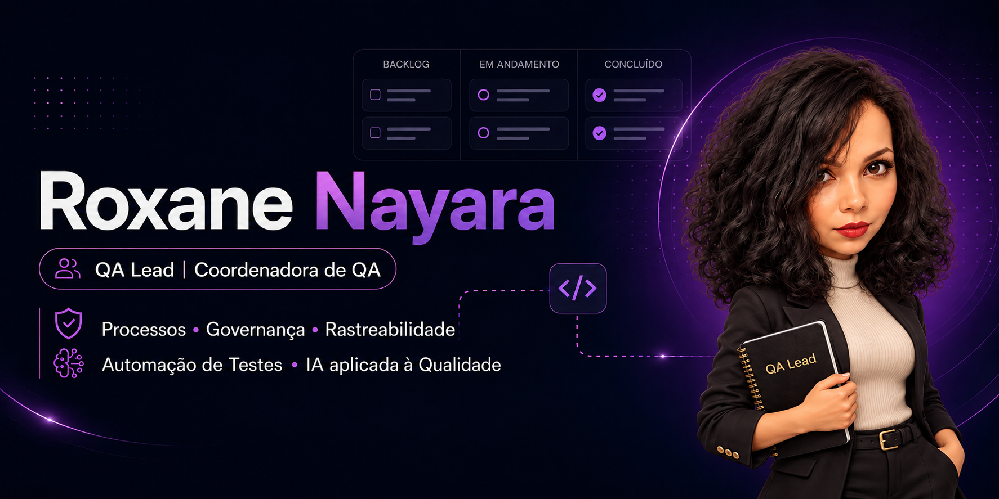

  

## Olá! 👋

Sou **QA Lead | Test Manager**, com experiência em liderança de times, Test Management, estratégia de testes, governança, gestão de riscos, rastreabilidade, métricas e evolução de processos de Qualidade de Software.

Minha trajetória em QA passou da atuação operacional à liderança, incluindo a estruturação de uma área de Qualidade desde o início e a condução de um time de 5 profissionais de QA. Mantenho a prática técnica ativa com projetos de automação Web, API, performance e mobile.

         
 
         

## Sobre mim

- Liderança e desenvolvimento de times de QA
- Test Management, estratégia e planejamento de testes
- Estruturação e evolução de processos de Qualidade de Software
- Risk-Based Testing e gestão de riscos
- Governança, rastreabilidade e gestão de defeitos
- Métricas, indicadores, Quality Gates e Release Readiness
- Maturidade de testes com referência em TMMi
- Azure DevOps aplicado à gestão e governança de QA
- Testes de APIs, integrações e performance
- Automação de testes como parte da estratégia de Qualidade
- IA aplicada à Qualidade de Software

## IA aplicada à Qualidade

Tenho explorado e aplicado IA como apoio à gestão, análise e tomada de decisão em Qualidade de Software, mantendo o julgamento humano como parte essencial do processo.

- **QA Intelligence** — agente integrado ao Azure DevOps para apoiar consultas e consolidação de indicadores de Qualidade, reduzindo o processo mensal de extração de KPIs de aproximadamente 6 horas para cerca de 2 horas.
- **Prisma QA** — agente criado para apoiar análises críticas de processos, regras de negócio, riscos e cenários de teste.
- **[TeamBalance](https://github.com/RoxaneNayara/teambalance)** — aplicação web gerada com IA generativa a partir de um prompt. Após a geração, documentei as regras de negócio e realizei os testes com base nelas.

Também estudo aplicações de IA em testes de LLMs, RAG, avaliação de respostas, prompt injection e uso de agentes com ferramentas.

Essas iniciativas fazem parte da minha busca por combinar governança, dados, pensamento crítico, automação e IA de forma responsável dentro da Engenharia de Qualidade.

## Projetos em destaque

| Projeto | Foco | Stack |
| --- | --- | --- |
| [Playwright Automation Lab](https://github.com/RoxaneNayara/playwright-automation-lab) | Automação Web, API e testes de sistemas com LLM, com quality gates e CI | Playwright, TypeScript, Allure, GitHub Actions |
| [Banco API Tests](https://github.com/RoxaneNayara/banco-api-tests) | Automação de API REST: autenticação, transferências, regras de negócio e paginação | JavaScript, Mocha, Chai, Supertest, Mochawesome |
| [Banco API Performance](https://github.com/RoxaneNayara/banco-api-performance) | Testes de carga com usuários virtuais, checks e thresholds de desempenho | Grafana k6, JavaScript |
| [Desafio Técnico QA – EBAC Shop](https://github.com/RoxaneNayara/ebac-shop-qa-challenge) | Automação E2E, segurança, integração e performance, com priorização por risco | Playwright, TypeScript, GitHub Actions |
| [TeamBalance](https://github.com/RoxaneNayara/teambalance) | Aplicação gerada com IA, regras de negócio documentadas e testes manuais | HTML, CSS, JavaScript, IA generativa |
| [Lojinha Mobile](https://github.com/RoxaneNayara/lojinhaMobileAutomacao) | Automação mobile com Page Object (projeto de estudo, 2022) | Appium, Java, JUnit 5 |
| [Quality Hub API Java](https://github.com/RoxaneNayara/quality-hub-api-java) | API REST para aprofundar testes de APIs e integrações (em desenvolvimento) | Java 21, Spring Boot, PostgreSQL |

> No contexto profissional, participei da adoção e evolução de uma POC de automação com Playwright em C#, trabalhando em conjunto com especialista de automação. Os projetos acima são autorais ou de estudo.

## Tecnologias e referências

**Liderança e gestão:**  
QA Leadership, Test Management, estratégia de testes, planejamento, gestão de riscos, métricas, Quality Gates, Release Readiness e melhoria contínua

**Processos e governança:**  
Azure DevOps, Jira, Kanban, Scrum, TMMi, DoD, RACI, rastreabilidade e gestão de defeitos

**Qualidade e testes:**  
testes funcionais, exploratórios, regressivos, Web, API, integração, performance, mobile, acessibilidade e Risk-Based Testing

**Automação:**  
Playwright, TypeScript, JavaScript, Mocha, Chai, Supertest, Cypress, Appium e C# em contexto de POC profissional

**APIs e dados:**  
Postman, Swagger, OpenAPI, GraphQL e SQL

**Performance:**  
Grafana k6

**CI/CD e relatórios:**  
GitHub Actions, Allure e Mochawesome

**IA aplicada à Qualidade:**  
agentes de IA, análise de processos, métricas, testes de LLMs, RAG e avaliação de respostas

**Referências de Qualidade:**  
TMMi, ISTQB, ISO/IEC 25010 e ISO/IEC/IEEE 29119

**Em estudo na Mentoria em Testes e Qualidade de Software 2.0:**  
mocks de APIs com Mockoon, performance de frontend com Lighthouse, acessibilidade com axe e verificação de links quebrados com Broken Link Checker

**Em desenvolvimento:**  
Java 21, Spring Boot, Maven e persistência de dados

## Conecte-se comigo

- [LinkedIn](https://www.linkedin.com/in/roxane-nayara/)
- [Site profissional](https://roxanenayara.github.io/)

---

**Qualidade de Software além da execução de testes: estratégia, risco, governança, engenharia e melhoria contínua.**
